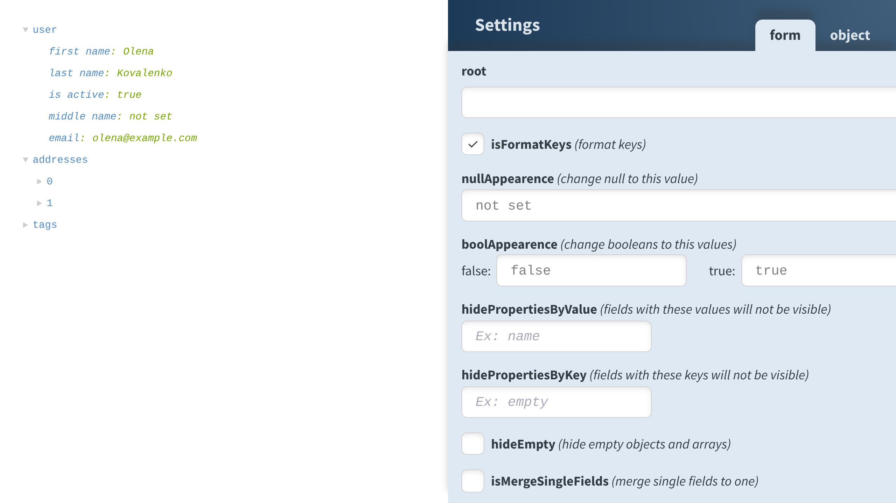

# JSON Custom View Demo Application

[](https://github.com/polina-prokofieva/json-custom-view-app/actions/workflows/deploy.yml)
[](https://www.npmjs.com/package/json-custom-view)

**[Open the live demo](https://polina-prokofieva.github.io/json-custom-view-app/)**

Hands-on demo of the [json-custom-view](https://www.npmjs.com/package/json-custom-view) package. Load your JSON, adjust the settings and see the result right away, then reuse the generated `Settings` object in your own project.



## Features

- **Load JSON** by uploading a file or pasting it as a string.
- **Adjust every setting** of `json-custom-view` in a form, for example `root`, `isFormatKeys`, `nullAppearence`, `boolAppearence`, hidden keys and values, `keysForArrays` and `arraysAsTable`.
- **Preview the result live** as you change the settings.
- **Copy the `Settings` object** from the **object** tab, or edit it there directly as JSON.
- **Download the transformed JSON** with the **Get transformed JSON** button.
- **Pick up where you left off.** Your JSON and settings are saved in the browser, so you can restore them on your next visit.

## Using the settings

Copy the object from the **object** tab and pass it to `generate` from `json-custom-view`:

```js
import { generate } from 'json-custom-view';

// Copied from the "object" tab of the demo app
const settings = {
  isFormatKeys: true,
  nullAppearence: 'not set',
  arraysAsTable: ['addresses'],
};

const root = document.querySelector('#main');

generate(data, root, settings);
```

To get the converted object without rendering it, use `transform(data, settings)`. See the [package documentation](https://www.npmjs.com/package/json-custom-view) for the full list of settings.

## Development

This app is built with [Vite](https://vitejs.dev/), [React](https://reactjs.org/) and [TypeScript](https://www.typescriptlang.org/).

### Install dependencies

```
npm install
```

### Launch the dev server locally

```
npm run dev
```

The app opens at `http://localhost:5173/json-custom-view-app/`.

### Create a local build

```
npm run build
```

Every push to `main` builds the app and deploys it to GitHub Pages.

## Related links

- [Live demo](https://polina-prokofieva.github.io/json-custom-view-app/)
- [json-custom-view documentation](https://www.npmjs.com/package/json-custom-view)
- [json-custom-view Git repository](https://github.com/polina-prokofieva/json-custom-view)
